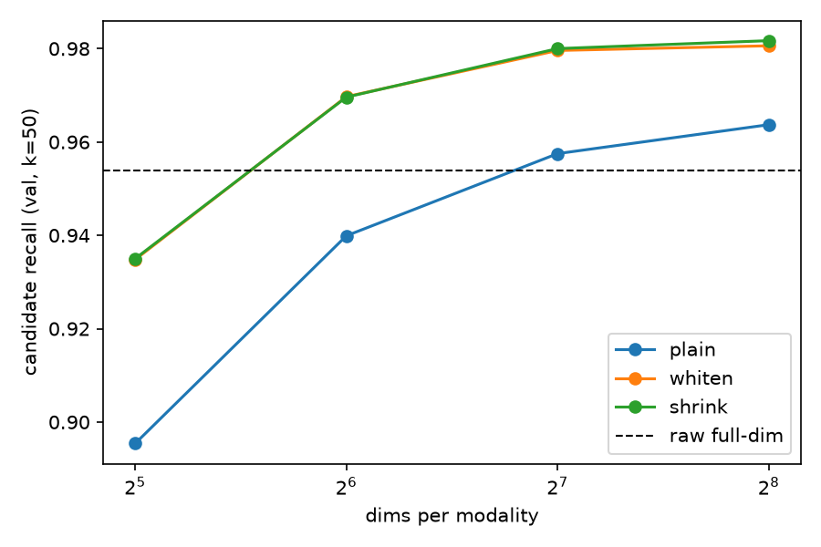
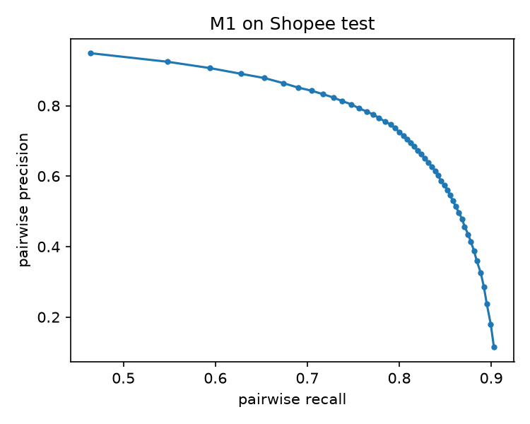
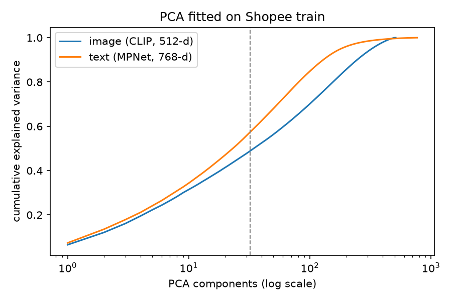

# DupeLens

**Finds the same product listed by different sellers, and shows each listing's price against the typical (median) price for that product.**

A logistic-regression matcher over image, text and variant-aware features reaches **per-listing F1 0.838 (95% CI 0.825–0.851)** on a held-out set of Shopee product groups, against 0.461 for a self-only floor and 0.794 for the best single feature. Applied unchanged to Amazon India personal-care appliances, it groups listings of the same item and flags 52 listings priced more than 20% above the typical price.

**Live dashboard: https://dupelens.vercel.app**

Every number below comes from code in this repo; the raw rows are in `results/results.csv`.

## The problem

On Amazon and Flipkart one product often appears as many separate listings from different sellers, with different titles, photos and prices (for example the same hair-straightener comb at ₹299, ₹399 and ₹499). Buyers cannot tell which listings are the same item, or whether a cheaper one is a different variant or pack size.

## How it works

1. **Data.** Shopee Price Match Guarantee (Kaggle): 34,250 listings in 11,014 product groups (`label_group` = same product). Split **by product group** 70/15/15 (seed 42): train 24,065 listings / 7,710 groups, validation 5,045 / 1,652, test 5,140 / 1,652. No product appears in two splits, so the test score measures matching *new* products.
2. **Embeddings.** CLIP ViT-B/32 image vectors (512-d) and multilingual MPNet title vectors (768-d), unit length; perceptual hash (`imagehash.phash`) recomputed for every photo.
3. **PCA.** One PCA per modality, fitted on train only, with shrinkage whitening (Λ + εI)^-1/2, ε = 10% of the mean eigenvalue, then re-normalised. Kept **32 dims per modality**, the smallest setting whose validation F1 fell inside the full-dimension confidence interval.
4. **Candidates.** FAISS exact inner-product search, top k = 50 neighbours within a split (k = 50 beat k = 20 by more than 2 recall points on validation).
5. **Pair features (symmetric):** image cosine, text cosine, TF-IDF char 3–5-gram cosine, phash Hamming distance, number-token match/conflict (e.g. "500 ml" vs "1 l"), mutual-neighbour flag, min/max rank, title length ratio. **Price is never a feature**, otherwise the price comparison would be circular.
6. **Model.** Logistic regression on standardised features with balanced class weights (positive share of train candidate pairs: 6.0%), probability threshold tuned on validation (0.82). **Test was used exactly once.**

## Results (Shopee test, single run)

| Step | Model | Test F1 | 95% CI | Pair precision | Pair recall |
|---|---|---|---|---|---|
| B0 | Self-only floor | 0.461 | 0.442–0.481 | – | 0.000 |
| B1 | Exact Shopee image hash | 0.547 | 0.527–0.569 | 0.994 | 0.107 |
| B2 | Best single feature (TF-IDF, tuned cutoff) | 0.794 | 0.780–0.807 | 0.782 | 0.694 |
| Ablation | M1 without number tokens | 0.833 | 0.821–0.846 | 0.827 | 0.708 |
| **M1** | **Logistic regression** | **0.838** | **0.825–0.851** | 0.833 | 0.717 |
| M2 | Small MLP (32-16) | 0.843 | 0.830–0.855 | 0.846 | 0.715 |
| M1 + components | Grouping rule (connected components, conflict edges dropped) | 0.816 | 0.802–0.830 | 0.760 | 0.817 |

F1 is per listing with the self-match counted (Kaggle convention); CIs bootstrap product groups (1,000 resamples). Candidate recall on test was 0.906 (CI 0.882–0.934), which caps pairwise recall. M2 is within M1's CI, so the simpler, interpretable M1 is the main model.

**Compression (validation).** Candidate recall with raw full-dimension vectors was 0.954; with shrinkage-whitened PCA it was 0.935 at 32 dims and 0.982 at 256 dims. Whitening raised recall over plain PCA at every size (e.g. 0.970 vs 0.940 at 64 dims), so compression with whitening is not just smaller but better at 64+ dims. M1 validation F1: raw 0.846, 32-d 0.843 (inside the raw CI 0.836–0.856).

**What the model weighs (standardised coefficients):** TF-IDF cosine +2.01, phash distance −0.54, number conflict −0.53, image cosine +0.42, text cosine −0.19. Text cosine is negative because it is strongly correlated with TF-IDF cosine, so the two split the weight; it does not mean similar meaning hurts.

**Where it fails.** Of 15 sampled false matches, 14 were variants (same brand or product line, different item); of 15 misses, 5 were variants (labelled as one product despite different size/shade), 3 garbled or abbreviated titles, 3 stock photo vs product photo, 2 bundles, 2 label noise.

  

## India price demo (Amazon India, Personal Care Appliances, 2023 snapshot)

- **Category choice.** Jewellery was tried first; its titles are templated and only 1 of 150 sampled predicted matches was truly the same product. A duplicate probe (`results/phase1_search/duplicate_probe.py`) then found Personal Care Appliances has by far the most true duplicate listings (599 pairs with near-identical photo and title under different ASINs). 698 listings kept after dropping 372 with dead images.
- **Distribution shift.** At 32 dims the frozen Shopee PCA explains 0.503 of Indian image variance (Shopee test 0.479) and 0.570 of text variance (0.563): little shift in the embeddings, but the Shopee threshold over-matches inside one narrow category.
- **Calibration.** 150 blind-labelled pairs: stratum-weighted precision at the Shopee threshold was 0.39 (CI 0.27–0.50), rising to 0.74 above probability 0.99. The India match threshold is therefore 0.99.
- **Held-out precision.** On 60 *new* labelled matches above 0.99: **precision 0.50 (CI 0.37–0.63)** under a strict rule (same model *and* same colour and pack). Of the 30 false matches, 11 were the same model in another colour, 7 combo packs with different contents, 7 a single item vs a multi-colour/multi-pack set, 5 other.
- **Price output.** 417 of 698 listings have at least one high-confidence match, 339 have a typical price (3+ listings), 52 are priced more than 20% above it. Prices use each listing's direct matches; connected components chained into one 100+ listing group on Indian data.

**Labelling disclosure:** the Indian match labels (150 calibration + 60 held-out pairs) and the 30 Shopee error tags were made by **Claude, an AI assistant**, blind to model scores, from titles and photos. No human labels were collected, so no inter-annotator agreement could be measured.

## Limits

- Shopee has no prices; the price comparison runs only on the Indian snapshot, which is a 2023 scrape, not live prices.
- India precision rests on 60 AI-labelled pairs; its CI is wide.
- Colour variants are the main India error: the image features at 32 dims do not separate shades of the same model well.
- Number tokens miss karat ("22 K") and model codes; the brand "3M" is read as 3 metres.

## Reproduce

```bash
python3.11 -m venv --copies .venv && .venv/bin/pip install torch sentence-transformers faiss-cpu scikit-learn pandas numpy matplotlib imagehash pillow requests kaggle six pytest
kaggle competitions download -c shopee-product-matching -p data/ && unzip data/shopee-product-matching.zip -d data/
.venv/bin/python -m pytest tests            # 25 unit tests
.venv/bin/python -m src.data                # group split
.venv/bin/python -m src.india               # Indian listings + photos (category in src/config.py)
.venv/bin/python -m src.embed               # embeddings + phash (Apple GPU 'mps' if available)
.venv/bin/python -m src.candidates          # PCA sweep, candidate recall
.venv/bin/python -m src.train               # baselines, M1, M2, ablation (validation)
.venv/bin/python -m src.train --test        # the single test run (refuses a second run)
.venv/bin/python -m src.india --frozen      # India calibration sample
.venv/bin/python -m src.india --matches     # India price view + held-out sample
.venv/bin/python -m src.export              # plots + dashboard data
.venv/bin/python -m http.server 8765 --directory dashboard   # open http://localhost:8765 (live: https://dupelens.vercel.app)
```

`notebooks/dupelens.ipynb` runs the same steps and shows the results. On an exFAT drive, delete macOS `._*` sidecar files after big writes (`find . -name '._*' -delete`). Do not import torch and faiss in one process unless faiss is imported first.

## Future work (not in this build)

- More Indian categories (one setting in `src/config.py`, then re-run the India steps).
- A colour feature to separate colour variants; karat and model-code tokens.
- Human labels with a second annotator for agreement.
- Live scraping, CLIP fine-tuning or ArcFace, approximate search (IVF/HNSW), price prediction, listing photos on the dashboard.

## Resume bullet

Built DupeLens, a duplicate-listing classifier trained on 34k Shopee listings (product-group split) using image, text, and variant-aware features; logistic regression reached test F1 0.838 (95% CI 0.825–0.851) vs 0.794 for the best single-feature baseline, with number-token features adding 0.45 points. Compressed image and text embeddings from 512/768 to 32 dimensions each with PCA and shrinkage whitening, keeping validation F1 at 0.843 vs 0.846 at full dimension. Applied to 698 Amazon India personal-care listings at 50% precision on held-out labelled matches, flagging 52 listings priced more than 20% above the typical price for the same product.
